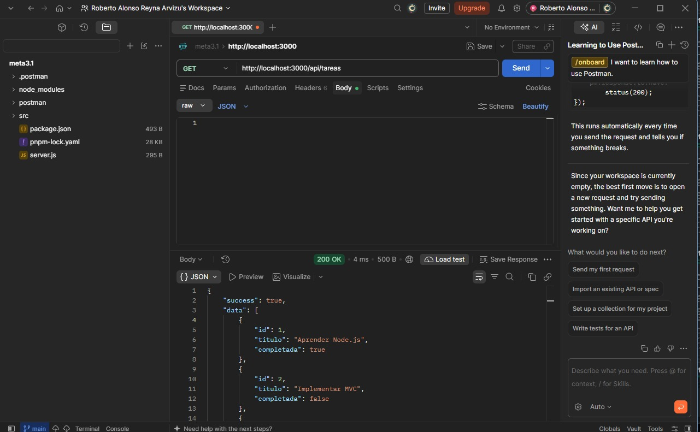
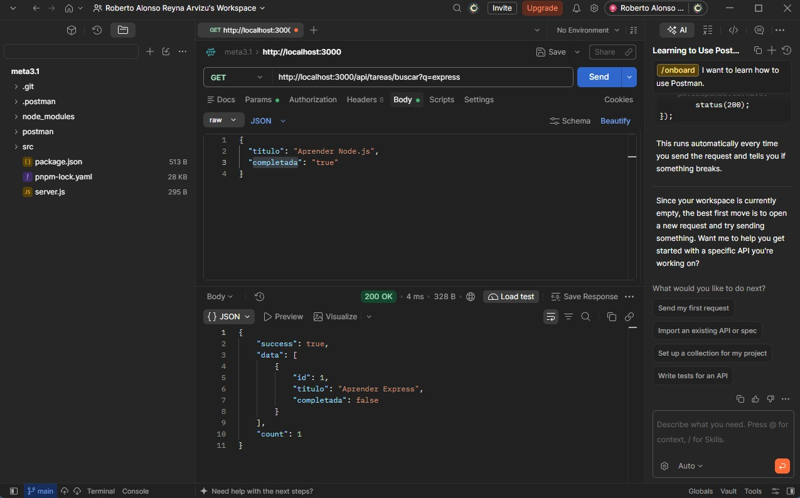
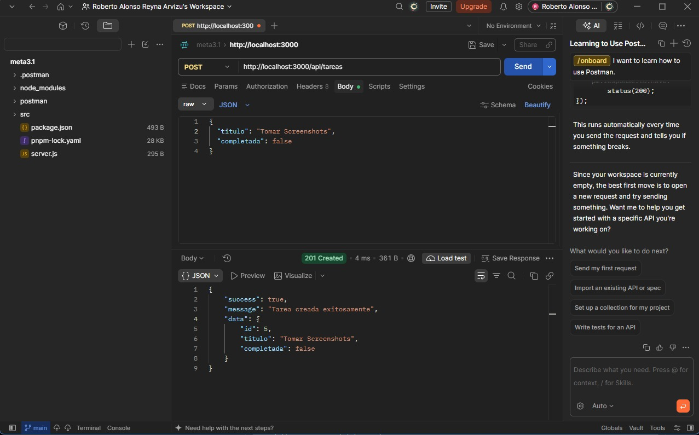
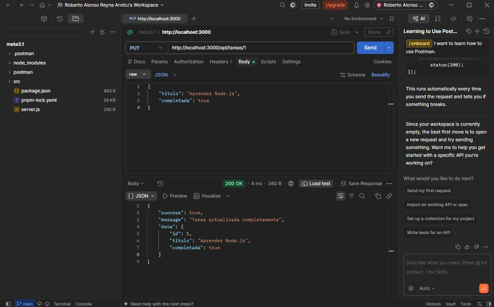
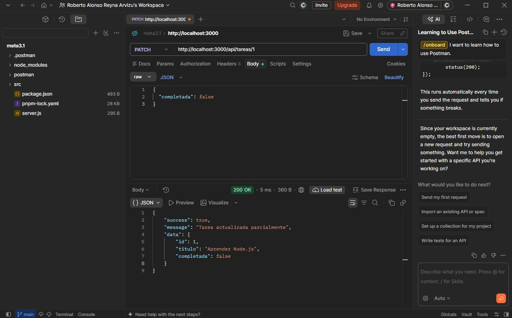
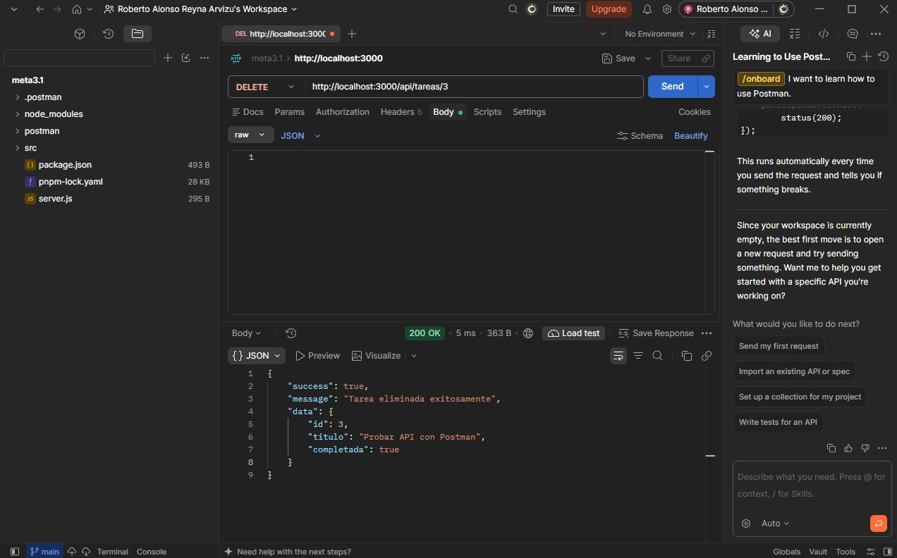
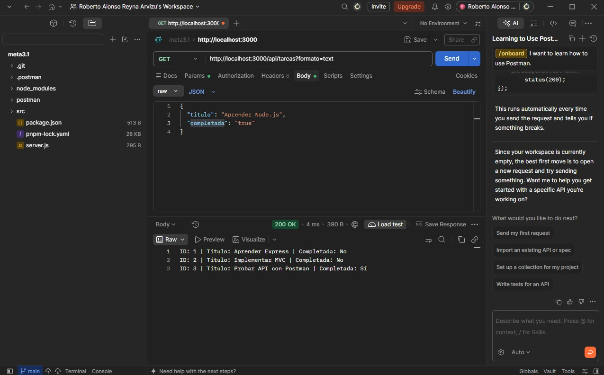
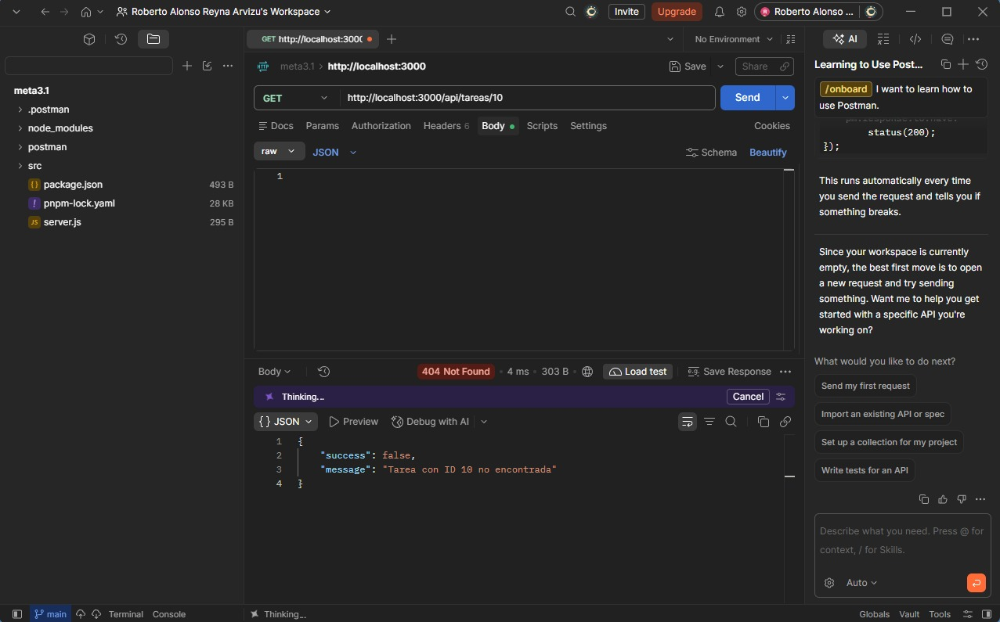
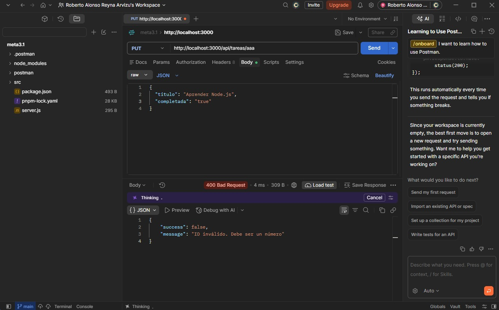
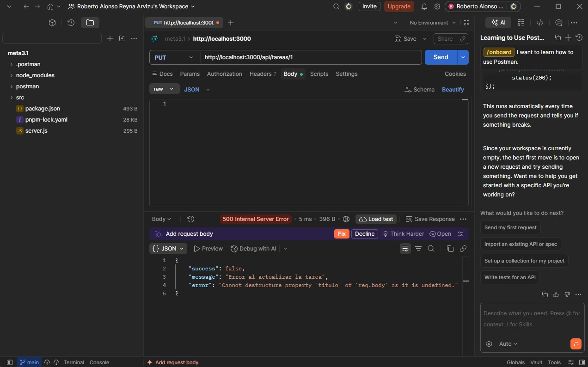

# API REST de Tareas

## Descripción del proyecto

API REST desarrollada con Node.js y Express para gestionar tareas mediante operaciones CRUD (Create, Read, Update, Delete).

El proyecto implementa el patrón de arquitectura MVC (Modelo-Vista-Controlador) y utiliza un arreglo en memoria como mecanismo de almacenamiento de datos.

La API permite crear, consultar, buscar, actualizar y eliminar tareas. También permite obtener las tareas en formato JSON o texto plano.

## Tecnologías utilizadas

- Node.js
- Express 5
- JavaScript ES Modules
- pnpm
- REST Client para VS Code
- Postman

## Requisitos previos

Antes de instalar el proyecto, es necesario contar con:

- Node.js
- pnpm

## Instalación

1. Clonar el repositorio:

   ```bash
   git clone https://github.com/RAReyna/meta-3.1
   ```

2. Entrar al directorio del proyecto:

   ```bash
   cd meta3.1
   ```

3. Instalar las dependencias:

   ```bash
   pnpm install
   ```

## Ejecución

Para iniciar el servidor en modo desarrollo:

```bash
pnpm run dev
```

El servidor estará disponible en:

```text
http://localhost:3000
```

## Estructura del proyecto

```text
meta3.1/
├── src/
│   ├── models/
│   │   └── tarea.model.js
│   ├── controllers/
│   │   └── tarea.controller.js
│   ├── routes/
│   │   └── tarea.routes.js
│   └── app.js
├── server.js
├── package.json
├── pnpm-lock.yaml
├── test-collection.http
└── README.md
```

## Endpoints disponibles

La API utiliza la ruta base:

```text
http://localhost:3000/api/tareas
```

| Método | Endpoint | Descripción |
|---|---|---|
| GET | `/api/tareas` | Obtener todas las tareas |
| GET | `/api/tareas?formato=text` | Obtener todas las tareas en texto plano |
| GET | `/api/tareas/:id` | Obtener una tarea por ID |
| GET | `/api/tareas/buscar?q=express` | Buscar tareas por título |
| GET | `/api/tareas/buscar?q=express&formato=text` | Buscar tareas y devolver texto plano |
| POST | `/api/tareas` | Crear una tarea |
| PUT | `/api/tareas/:id` | Actualizar una tarea completamente |
| PATCH | `/api/tareas/:id` | Actualizar una tarea parcialmente |
| DELETE | `/api/tareas/:id` | Eliminar una tarea |

### Ejemplos de solicitudes

**POST – Crear una tarea**

```json
{
  "titulo": "Aprender Express",
  "completada": false
}
```

**PUT – Actualizar una tarea**

```json
{
  "titulo": "Implementar arquitectura MVC",
  "completada": true
}
```

**PATCH – Actualizar parcialmente**

```json
{
  "completada": true
}
```

## Pruebas

Los endpoints fueron probados utilizando Postman.

También se incluye el archivo `test-collection.http`, que permite ejecutar las solicitudes desde Visual Studio Code mediante la extensión REST Client.

### Capturas de pantalla

Las siguientes imágenes muestran las pruebas realizadas en Postman:

#### 1. Obtener todas las tareas (GET)



#### 2. Buscar tareas por título (GET)



#### 3. Crear una tarea (POST)



#### 4. Actualizar una tarea (PUT)



#### 5. Actualizar parcialmente una tarea (PATCH)



#### 6. Eliminar una tarea (DELETE)



#### 7. Recibir en formato de texto (GET)



#### 8. Mostrar error 404 (GET)



#### 7. Mostrar error 400 (PUT)



#### 7. Mostrar error 500 (PUT)



## Persistencia de datos

El proyecto utiliza un arreglo en memoria para almacenar las tareas. Por lo tanto, los datos no son persistentes y se restablecen cuando se reinicia el servidor.

## Arquitectura MVC

El proyecto está organizado en tres componentes principales:

- **Modelo:** administra los datos y las operaciones sobre las tareas.
- **Controlador:** procesa las solicitudes HTTP, ejecuta la lógica correspondiente y genera las respuestas.
- **Rutas:** define los endpoints y conecta las solicitudes con los métodos del controlador.

## Diferencia entre PUT y PATCH

Ambos métodos HTTP permiten actualizar una tarea, pero se utilizan de manera diferente:

- **PUT (actualización completa):** reemplaza los datos de la tarea. En esta practica se requiere el campo `titulo` y permite establecer `completada`. Si no se proporciona `completada`, toma el valor `false`.
- **PATCH (actualización parcial):** modifica únicamente los campos enviados en la petición. Los demás datos de la tarea se conservan sin cambios. Requiere al menos un campo para actualizar.

## Códigos de estado HTTP

La API utiliza los siguientes códigos de estado para indicar el resultado de las peticiones:

| Código | Nombre | Cuándo se utiliza |
| ------ | ------ | ----------------- |
| 200 | OK | La petición se procesó correctamente. Se utiliza en consultas, actualizaciones y eliminaciones exitosas. |
| 201 | Created | Una tarea se creó correctamente mediante POST. |
| 400 | Bad Request | La petición contiene datos inválidos, faltan campos obligatorios o el ID proporcionado no es válido. |
| 404 | Not Found | No se encontró una tarea con el ID solicitado. |
| 500 | Internal Server Error | Ocurrió un error inesperado durante el procesamiento de la petición. |

Estos códigos permiten que el cliente identifique si una operación se realizó correctamente o si ocurrió algún problema.
